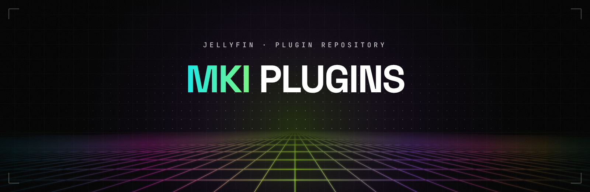

<div align="center">



# MKI Jellyfin Plugins

Plugins for [Jellyfin](https://jellyfin.org) 12, installable from one plugin repository.

[](https://github.com/MKI002/mki-jellyfin-plugins/actions/workflows/build.yml)
[](https://github.com/MKI002/mki-jellyfin-plugins/releases)

[](LICENSE)

</div>

## Plugins

<table>
  <tr>
    <td width="320" valign="top">
      <a href="src/Jellyfin.Plugin.MediaHero"></a>
    </td>
    <td valign="top">
      <h3><a href="src/Jellyfin.Plugin.MediaHero">MKI Media Hero</a></h3>
      A cinematic hero carousel on the home screen, built on the server from recent, top rated and Seerr trending titles, with per-library whitelists and blacklists.
    </td>
  </tr>
  <tr>
    <td width="320" valign="top">
      <a href="src/Jellyfin.Plugin.MkiMergeVersions"></a>
    </td>
    <td valign="top">
      <h3><a href="src/Jellyfin.Plugin.MkiMergeVersions">MKI Merge Versions</a></h3>
      Merges movies that exist in several resolutions into one entry, matched by TMDb or IMDb ID. The highest resolution becomes the primary version.
    </td>
  </tr>
  <tr>
    <td width="320" valign="top">
      <a href="src/Jellyfin.Plugin.SeerrBridge"></a>
    </td>
    <td valign="top">
      <h3><a href="src/Jellyfin.Plugin.SeerrBridge">MKI Seerr Bridge</a></h3>
      Seerr inside the Jellyfin web client: a menu button, an embedded view, request suggestions in search, and optional single sign-on.
    </td>
  </tr>
  <tr>
    <td width="320" valign="top">
      <a href="src/Jellyfin.Plugin.MkiPasswordPolicy"></a>
    </td>
    <td valign="top">
      <h3><a href="src/Jellyfin.Plugin.MkiPasswordPolicy">MKI Password Policy</a></h3>
      Password rules per user and forced password changes that hold on every device. Changes nothing about sign-ins until you assign a profile or ask for a new password.
    </td>
  </tr>
  <tr>
    <td width="320" valign="top">
      <a href="src/Jellyfin.Plugin.MkiContinueWatching"></a>
    </td>
    <td valign="top">
      <h3><a href="src/Jellyfin.Plugin.MkiContinueWatching">MKI Continue Watching Cleanup</a></h3>
      A Remove button on Continue Watching cards, with Undo, and an optional daily cleanup of what nobody has played for a set number of days. Only the resume position is cleared; nothing is deleted.
    </td>
  </tr>
</table>

## Installation

1. In Jellyfin, open **Dashboard → Plugins → Repositories** (on older layouts: **Catalog → ⚙ Settings**).
2. Add a repository:
   - **Name:** `MKI Plugins`
   - **URL:**
     ```
     https://raw.githubusercontent.com/MKI002/mki-jellyfin-plugins/main/manifest.json
     ```
3. Open the **Catalog**, pick a plugin and click **Install**.
4. Restart Jellyfin, then open the plugin's settings page under **Dashboard → Plugins**.

Updates show up in the catalog automatically when a new version is released.

### Requirements

- Jellyfin **12.x** (plugin ABI `12.0.0.0`). Older servers will not list the plugins.
- **MKI Media Hero** and **MKI Seerr Bridge** add a small script to the Jellyfin web client by writing to its `index.html`. **MKI Password Policy** does the same; its sign-in dialog and popups only switch on while a profile is assigned or a password change is pending (otherwise the script only adds the administrator's shortcut on user pages), and uninstalling removes it. **MKI Continue Watching Cleanup** adds its script only while its Remove button is turned on. The Jellyfin process needs write access to the web folder for that; the official Docker image has it.
- **MKI Seerr Bridge**, and MKI Media Hero's trending source, need a running [Seerr](https://github.com/seerr-team/seerr) instance and its API key.

## Building from source

You need the [.NET 10 SDK](https://dotnet.microsoft.com/download).

```bash
dotnet build MkiJellyfinPlugins.sln -c Release
```

Each plugin's DLL lands in `src/<Plugin>/bin/Release/net10.0/`. To install by hand, copy that DLL together with the plugin's `meta.json` into a new folder under your Jellyfin data directory's `plugins/` folder and restart Jellyfin.

### Settings pages

All settings pages share one design kit in `ui/` (`mki-kit.css` and `mki-kit.js`): the status header, the tabs, settings that save themselves with undo, and the dialogs. Each `configPage.html` carries its own copy between `MKI-KIT` markers, so a page never depends on another plugin being installed. After changing anything in `ui/`, run:

```bash
python3 build/kit.py --write
```

CI fails when a page's copy is out of date (`build/package.py --check` runs `build/kit.py --check`).

## Releasing a new version

Every update and every new plugin goes through the checks and review steps in [RELEASING.md](RELEASING.md) first. CI enforces them on every pull request.

1. Raise `version` and update `changelog` in the plugin's `src/<Plugin>/meta.json`.
2. Merge to `main`.
3. Start the release: either open **Actions → Release → Run workflow** and enter a tag such as `v1.1.0`, or push that tag yourself (`git tag v1.1.0 && git push origin v1.1.0`).

The [Release workflow](.github/workflows/release.yml) builds every plugin whose version is not yet in `manifest.json`, attaches the zips to a GitHub release for that tag and commits the updated `manifest.json` to `main`. Plugins whose version did not change are left alone. It refuses to run unless the Build workflow is green on that commit of `main`.

## Repository layout

```
.
├── manifest.json                    Jellyfin plugin repository (generated by the release workflow)
├── MkiJellyfinPlugins.sln
├── build/package.py                 builds, zips and updates manifest.json
├── build/kit.py                     copies the shared design kit into every settings page
├── build/checks.py                  release gates: English only, personal data, security, versions
├── build/security-baseline.json     reviewed anonymous endpoints and request middleware
├── RELEASING.md                     the steps every update goes through before release
├── ui/                              shared design kit of the settings pages
├── .github/workflows/               CI build and tag-triggered release
└── src/
    ├── Jellyfin.Plugin.MediaHero/
    ├── Jellyfin.Plugin.MkiContinueWatching/
    ├── Jellyfin.Plugin.MkiMergeVersions/
    ├── Jellyfin.Plugin.MkiPasswordPolicy/
    └── Jellyfin.Plugin.SeerrBridge/
        ├── meta.json                name, description, version and changelog
        ├── logo.png                 catalog image
        └── README.md                features and setup
```

## License

[GPL-3.0](LICENSE). Jellyfin itself is GPL licensed, and plugins build against its libraries.
