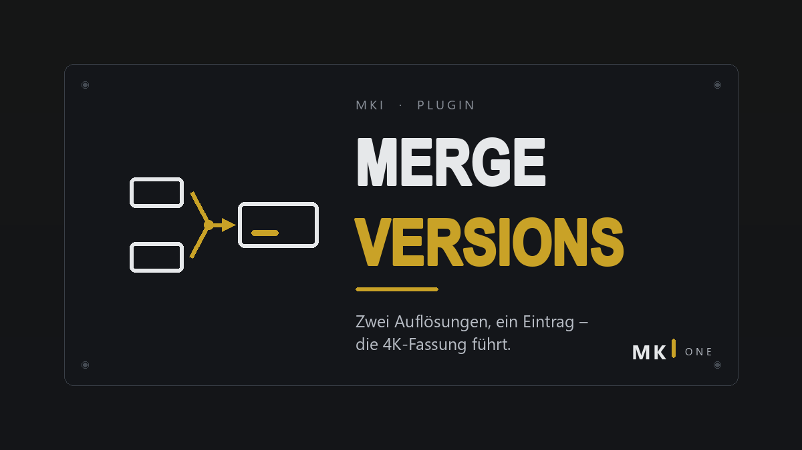

# MKI Merge Versions

Two resolutions, one entry. If a movie exists as 1080p and 2160p in separate folders, this plugin links them into a single library item, and the highest resolution becomes the primary version.

## Features

- **Safe matching.** Movies are grouped by TMDb ID, falling back to IMDb ID. Never by title and year. TV series are left untouched.
- **Highest resolution leads.** The best version becomes the primary entry. Optionally, existing links are rebuilt if a lower resolution is currently primary.
- **Runs on its own.** A scheduled task (*Library → Filme zusammenfuehren (MKI)*) runs at startup and every hour, and an extra run starts once the library has been quiet for five minutes after changes.
- **Dry run.** Log what would be merged without writing anything.

## Setup

1. Install from the plugin catalog and restart Jellyfin.
2. Open **Dashboard → Plugins → MKI Merge Versions**. Turn on the dry run first if you want to check the result in the Jellyfin log.
3. Click **Jetzt ausfuehren** (run now) or wait for the scheduled task.
